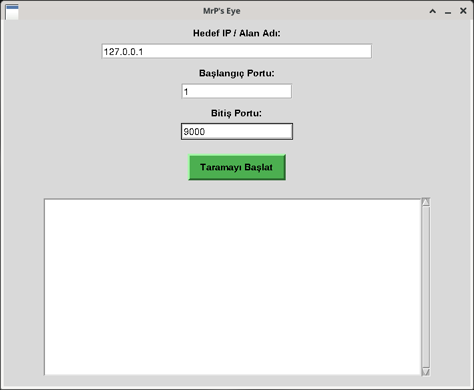
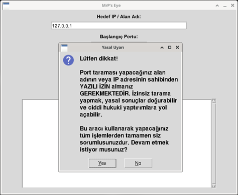
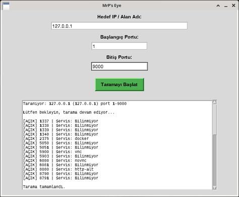

# Port Scanner (MrP's Eye)

Türkçe | [English](#english)

Tkinter arayüzlü basit bir TCP port tarayıcı. Hedef IP veya alan adı ve port aralığı girilir, açık portlar listelenir ve bilinen portlar için olası güvenlik riskleri gösterilir (FTP, Telnet, SMB, RDP vb.). Açık portlar `port_sonuclari.db` dosyasına kaydedilir.

## Gereksinimler

- Python 3 (tkinter ile birlikte)
- Ek paket gerekmez. tkinter, socket ve sqlite3 Python'un standart kütüphanesinde var.

## Kurulum ve çalıştırma (macOS)

1. Terminal'i açın ve Python'u kontrol edin:

   ```bash
   python3 --version
   ```

2. Repoyu indirip klasöre girin:

   ```bash
   git clone https://github.com/nemrebayraktar/python-security-tools.git
   cd python-security-tools/port-scanner
   ```

3. tkinter'ın kurulu olduğunu kontrol edin:

   ```bash
   python3 -c "import tkinter; print('tkinter hazır')"
   ```

   Hata verirse ve Python'u Homebrew ile kurduysanız `brew install python-tk` komutunu çalıştırın. python.org'dan indirilen Python'da tkinter zaten gelir.

4. Programı başlatın:

   ```bash
   python3 portscanner.py
   ```

Linux'ta adımlar aynı. tkinter yoksa `sudo apt install python3-tk` ile kurulur. Windows'ta `py portscanner.py` yeterli.

## Kullanım

1. Hedef IP / alan adı ile başlangıç ve bitiş portunu girin. Varsayılan hedef `127.0.0.1`, varsayılan aralık 1-1024.

   

2. "Taramayı Başlat" butonuna basın. Önce yasal uyarı çıkar, "Yes" denmeden tarama başlamaz.

   

3. Açık portlar servis adıyla listelenir. Altında her açık port için olası risk notu ve sonuçların kaydedildiği dosya yazılır.

   

Görseldeki tarama test makinesinin kendisinde (127.0.0.1, port 1-9000) yapıldı. Ekran görüntüleri Linux'ta alındığı için macOS'ta pencere ve yazı tipi biraz farklı görünür.

## Sonuçlar nereye kaydedilir

Açık port bulunursa sonuçlar script ile aynı klasördeki `port_sonuclari.db` dosyasına yazılır. Tablo: `ports (ip_address, port, service, risk_summary, scan_time)`. Terminalden bakmak için:

```bash
sqlite3 port_sonuclari.db "SELECT port, service, scan_time FROM ports;"
```

`.db` dosyaları gerçek IP bilgisi içerebileceği için repoya eklenmez.

## Bilinen kısıtlar

- Yalnızca TCP connect taraması yapar. UDP ve servis sürümü tespiti yoktur, servis adı bilinen port listesinden gelir.
- 100 paralel bağlantı ve port başına 0.5 sn bekleme kullanılır. Kapalı ya da filtrelenmiş bir hedefte 1-65535 aralığının tamamı birkaç dakika sürebilir.

## Yasal not

Kendi makineniz dışında yalnızca izinli hedefleri tarayın (ör. Nmap'in test için izin verdiği `scanme.nmap.org`). İzinsiz tarama TCK 243-245 kapsamında suçtur.

---

## English

A simple TCP port scanner with a Tkinter GUI. Enter a target IP or hostname and a port range; it lists open ports, shows possible risks for well-known ones (FTP, Telnet, SMB, RDP etc.) and saves the results to `port_sonuclari.db`.

Requirements: Python 3 with tkinter. No extra packages.

Setup and run (macOS, Linux is the same):

1. Check Python: `python3 --version`
2. Get the code:

   ```bash
   git clone https://github.com/nemrebayraktar/python-security-tools.git
   cd python-security-tools/port-scanner
   ```

3. Check tkinter: `python3 -c "import tkinter; print('tkinter ok')"`. If it fails on Homebrew Python, run `brew install python-tk`. On Debian / Ubuntu use `sudo apt install python3-tk`.
4. Start it: `python3 portscanner.py` (on Windows `py portscanner.py`).

Using it: fill in the target and port range (default `127.0.0.1`, 1-1024), click "Taramayı Başlat", accept the legal warning, and the open ports are listed with service names and risk notes. The screenshots above show this flow on a Linux test machine scanning itself.

Results are saved to `port_sonuclari.db` next to the script when open ports are found (`sqlite3 port_sonuclari.db "SELECT port, service, scan_time FROM ports;"`). `.db` files are not committed.

Limits: TCP connect only, no UDP or version detection. With 100 parallel connections and a 0.5 s timeout, a full 1-65535 scan of a filtered host can take a few minutes.

Only scan your own machine or hosts you are allowed to test, such as `scanme.nmap.org`. Unauthorised scanning is illegal.
