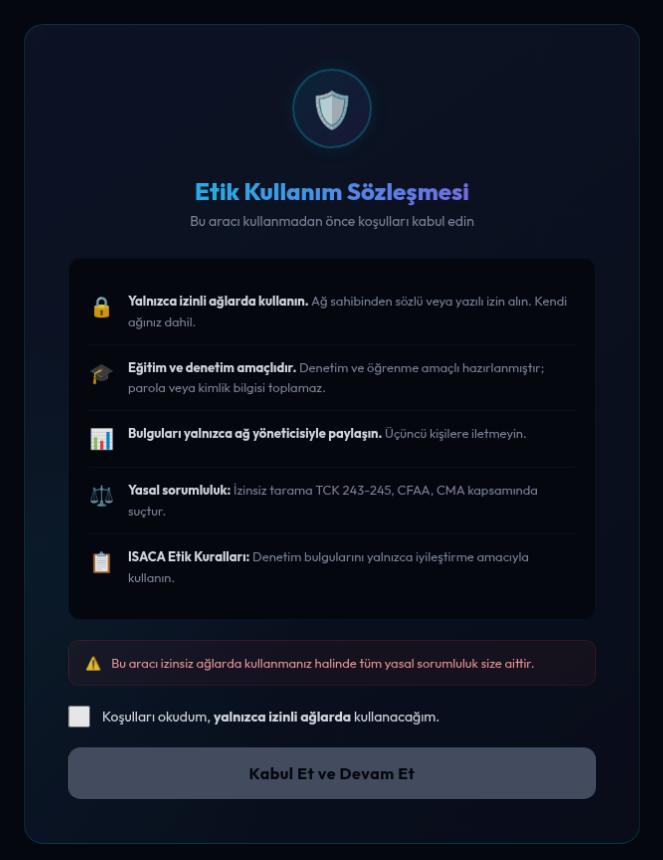
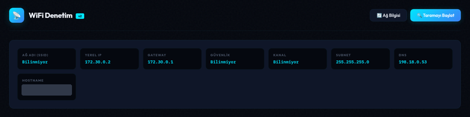
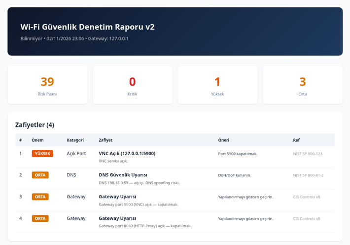

# WiFi Auditor

Türkçe | [English](#english)

Bağlı olduğum Wi-Fi ağının temel güvenlik durumunu hızlıca görmek için yazdığım Flask tabanlı araç. Masaüstü penceresinde (PyWebView) veya tarayıcıda çalışır, sonunda HTML rapor üretir. Kablosuz ağ farkındalık çalışmamda gördüğüm konuları (açık ağlar, eski şifreleme, HTTP üzerinden yönetim paneli gibi) kendi ağımda kontrol edebilmek için hazırladım.

## Ne kontrol eder

1. Bağlı ağ bilgisi: SSID, şifreleme türü, kanal, gateway, DNS, subnet
2. Çevredeki görünür Wi-Fi ağları ve şifreleme türleri (açık, WEP, WPA, WPA2, WPA3)
3. Cihaz keşfi: ARP tablosu, gerekirse /24 ağda ping taraması
4. Gateway ve bulunan ilk 20 cihazda 26 yaygın TCP port
5. 443 açıksa TLS sürümü ve sertifika doğrulaması
6. Birden fazla DHCP sunucusu (rogue DHCP) ve ARP tablosunda aynı MAC'i paylaşan IP'ler
7. DNS sunucularının bilinen sağlayıcı / ağ içi olup olmadığı
8. Sonuçlara göre NIST SP 800-153 ve CIS Controls referanslı bulgu listesi ve risk puanı

## Ne toplar, ne toplamaz

- Toplar: ağ adı (SSID), BSSID, yerel IP, gateway, DNS, ağdaki cihazların IP / MAC / hostname bilgisi, açık port numaraları. Bunlar yalnızca bellekte tutulur ve "Rapor Oluştur" denirse `~/wifi_audit_reports/` altına HTML olarak kaydedilir. Hiçbir yere gönderilmez.
- Toplamaz: parola, kimlik bilgisi, Wi-Fi anahtarı, trafik içeriği. Captive portal / sahte giriş sayfası değildir, kimseden bilgi istemez.
- Raporlar ağdaki cihazları içerdiği için paylaşmadan önce gözden geçirin, repoya eklemeyin.

## Etik kullanım

Araç tamamen pasif değildir: ping taraması ve port taraması yapar. Bu yüzden yalnızca kendi ağınızda veya ağ sahibinden açık (tercihen yazılı) izin aldığınız ağlarda kullanın. Ortak kullanılan ağlarda (yurt, ofis, kafe) ağ yöneticisinin izni olmadan çalıştırmayın. İzinsiz tarama TCK 243-245 kapsamında suçtur. Uygulama açılışta bu koşulların kabul edilmesini ister.

## Kurulum ve çalıştırma

Python 3.9 veya üstü gerekir. Tek zorunlu bağımlılık Flask. pywebview isteğe bağlıdır, kurulamazsa uygulama tarayıcıda açılır.

macOS (Linux'ta da aynı adımlar):

1. Terminal'i açın ve Python'u kontrol edin:

   ```bash
   python3 --version
   ```

2. Repoyu indirip klasöre girin:

   ```bash
   git clone https://github.com/nemrebayraktar/python-security-tools.git
   cd python-security-tools/wifi-auditor
   ```

3. Kurulum scriptini çalıştırın. `.venv` sanal ortamını kurar, Flask'ı (ve mümkünse pywebview'ı) yükler, `run.sh` ve `run_browser.sh` dosyalarını oluşturur:

   ```bash
   chmod +x setup.sh
   ./setup.sh
   ```

4. Uygulamayı başlatın ve tarayıcıda http://127.0.0.1:5050 adresini açın:

   ```bash
   ./run_browser.sh
   ```

   Ayrı pencerede açmak için `./run.sh` kullanılabilir (pywebview kuruluysa). Kapatmak için terminalde Ctrl+C.

Windows (PowerShell):

```powershell
cd python-security-tools\wifi-auditor
py -m venv .venv
.venv\Scripts\pip install -r requirements.txt
.venv\Scripts\python app.py --browser
```

Varsayılan port 5050'dir (macOS'ta 5000 portunu AirPlay Alıcısı kullandığı için değiştirildi). Port doluysa uygulama boş bir port seçer ve adresi terminale yazar. Başka bir port için `./run_browser.sh --port 8000` yazılabilir. Sunucu yalnızca 127.0.0.1 üzerinde dinler, başka bir sitenin arka planda tarama başlatması engellenmiştir.

## Kullanım

Ekran görüntüleri Linux bir test makinesinde alındı. macOS'ta görünüm aynı, yalnızca Wi-Fi bilgileri dolu gelir.

1. İlk ekranda etik kullanım koşulları çıkar. Kutucuk işaretlenip "Kabul Et ve Devam Et" denmeden araç açılmaz.

   

2. Ana sayfada bağlı olunan ağın bilgileri görünür: SSID, yerel IP, gateway, güvenlik türü, kanal, subnet ve DNS.

   

   Görseldeki test makinesinde Wi-Fi kartı olmadığı için SSID, güvenlik ve kanal "Bilinmiyor" görünüyor. Bilgisayar adını görselde kapattım.

3. "Taramayı Başlat" ile cihaz keşfi, port taraması ve DHCP / ARP / DNS kontrolleri çalışır. Ağdaki cihaz sayısına göre birkaç dakika sürebilir.

4. "Rapor Oluştur ve Kaydet" sonuçları HTML rapor olarak kaydeder. Raporda risk puanı, önem derecesine göre bulgular, öneriler ve referanslar bulunur.

   

   Bu örnek rapor test makinesinde yerel bir denemeden alındı.

## Raporlar nereye kaydedilir

Raporlar `~/wifi_audit_reports/` klasörüne `wifi_audit_<SSID>_<tarih>.html` adıyla kaydedilir ve tarayıcıda açılabilir. Bu klasör repo dışında, kullanıcının ana dizinindedir.

## Kullandığı sistem komutları

Araç ağ bilgilerini işletim sisteminin kendi komutlarından okur. Bir komut yoksa o bilgi "Bilinmiyor" olarak gelir, uygulama çalışmaya devam eder.

| Bilgi | macOS | Linux | Windows |
|---|---|---|---|
| SSID, şifreleme, kanal | `networksetup`, `airport -I` | `nmcli`, yoksa `iwgetid` / `iwconfig` | `netsh wlan show interfaces` |
| Gateway, DNS, subnet | `route -n get default`, `scutil --dns`, `ifconfig` | `ip route`, `ip addr`, `/etc/resolv.conf` | `ipconfig /all` |
| Çevredeki ağlar | `airport -s` | `nmcli dev wifi list` | `netsh wlan show networks mode=bssid` |
| Cihaz keşfi | `arp -a`, `ping` | `arp -a` veya `ip neigh`, `ping` | `arp -a`, `ping` |
| DHCP sunucusu | `ipconfig getpacket en0` | - | - |

Bilinen kısıtlar:
- macOS 14.4 ve sonrasında Apple `airport` komutunu kaldırdı. Bu sürümlerde çevredeki ağ listesi ve bazı Wi-Fi detayları boş gelebilir.
- macOS tarafında arayüz adı `en0` olarak varsayılır.
- Cihaz keşfi ağın /24 olduğunu varsayar. Rogue DHCP kontrolü yalnızca macOS'ta çalışır.
- Windows'ta `netsh` çıktısı dil ayarına göre değişebilir; İngilizce ve Türkçe başlıklar okunur.
- CISA-Toolkit de varsayılan olarak 5050 portunu kullanır. İkisi aynı anda açılırsa sonradan açılan boş bir port seçer, adres terminalde yazar. İstenirse `--port` ile ayrı port verilebilir.

---

## English

A Flask-based tool I wrote to quickly check the basic security posture of the Wi-Fi network I am connected to. It runs in a desktop window (PyWebView) or in the browser and produces an HTML report. I built it to check, on my own network, the issues I saw in my wireless awareness study (open networks, legacy encryption, HTTP-only admin panels and so on).

What it checks: connected network details, visible networks and their encryption, host discovery (ARP, ping sweep on a /24), 26 common TCP ports on the gateway and up to 20 hosts, TLS version and certificate validation on 443, rogue DHCP and duplicate MAC (ARP spoofing signs), DNS servers, and a findings list with a risk score referencing NIST SP 800-153 and CIS Controls.

What it collects: SSID, BSSID, local IP, gateway, DNS, IP / MAC / hostname of devices on the network and open port numbers. Kept in memory and saved as an HTML report under `~/wifi_audit_reports/` only when you click "generate report". Nothing is sent anywhere. It does not collect passwords, credentials, Wi-Fi keys or traffic content, and it is not a captive portal.

Ethical use: the tool is not purely passive (it does a ping sweep and a port scan). Use it only on your own network or with explicit, preferably written, permission from the network owner. Do not run it on shared networks (dorms, offices, cafés) without the administrator's permission. The app asks you to accept these terms on start.

Setup and run (macOS, Linux is the same). Python 3.9+ is needed; Flask is the only required dependency and pywebview is optional.

1. Check Python: `python3 --version`
2. Get the code:

   ```bash
   git clone https://github.com/nemrebayraktar/python-security-tools.git
   cd python-security-tools/wifi-auditor
   ```

3. Run the setup script. It creates a `.venv`, installs Flask (and pywebview if possible) and writes `run.sh` and `run_browser.sh`:

   ```bash
   chmod +x setup.sh
   ./setup.sh
   ```

4. Start it with `./run_browser.sh` and open http://127.0.0.1:5050 in your browser. `./run.sh` opens a separate window if pywebview is installed. Stop it with Ctrl+C.

On Windows: `py -m venv .venv`, `.venv\Scripts\pip install -r requirements.txt`, `.venv\Scripts\python app.py --browser`.

The default port is 5050 because macOS uses 5000 for AirPlay Receiver. If the port is busy the app picks a free one and prints it; you can also pass `--port 8000`. The server only listens on 127.0.0.1 and blocks cross-site requests that try to start a scan.

Using it: accept the ethical use terms on the first screen, check the network details on the main page, click "Taramayı Başlat" to run the checks (a few minutes depending on the number of devices), then "Rapor Oluştur ve Kaydet" to save the HTML report. Reports are saved as `~/wifi_audit_reports/wifi_audit_<SSID>_<date>.html`. The screenshots above were taken on a Linux test machine without a Wi-Fi card, so the SSID, security and channel fields show as unknown there.

System commands used: macOS `networksetup`, `airport`, `route`, `scutil`, `ifconfig`, `ipconfig getpacket`; Linux `nmcli` (or `iwgetid` / `iwconfig`), `ip route`, `ip addr`, `ip neigh`, `/etc/resolv.conf`; Windows `netsh wlan`, `ipconfig /all`; all systems `arp -a` and `ping`. If a command is missing the field shows as unknown and the scan continues.

Known limits: Apple removed the `airport` tool in macOS 14.4+, so the nearby network list may be empty there; macOS assumes the `en0` interface; host discovery assumes a /24; the rogue DHCP check works only on macOS. CISA-Toolkit also defaults to port 5050; if both run at the same time the second one picks a free port, or use `--port`.
